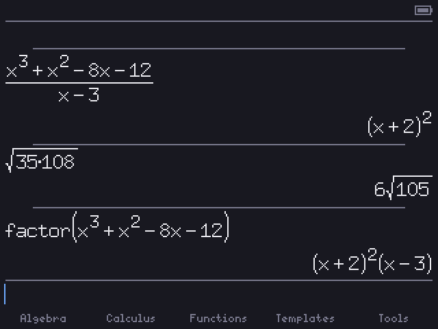
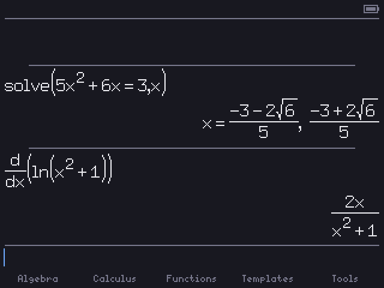

# Fluxion

**A CAS for the TI-84 Plus CE** that i'm trying to make simplify better than the TI-Nspire CAS does. You type math the way it looks (stacked fractions, roots, exponents), press enter, and get an exact answer.

<p>
  
  
</p>

<sub>screenshots are from the PC build, it draws the same pixels as the calculator</sub>

## What it does

- enter simplifies, cancels stuff in fractions, pulls square factors out of roots ($\sqrt{35\cdot108} \to 6\sqrt{105}$), keeps everything as exact fractions
- `factor(` polynomials, like $(x+2)^2(x-3)$
- `expand(`, `d/dx(`, and trig / log / hyperbolic identities
- `solve(` linear equations and polynomials with number coefficients: $x = \frac{-3-2\sqrt{6}}{5}, \frac{-3+2\sqrt{6}}{5}$
- an actual 2D editor with templates for fractions, roots, exponents and $\lvert x\rvert$, and the cursor moves through them
- nspire style layout, history on top, input on the bottom, the five keys under the screen open folders of commands

Its still a work in progress, no systems of equations, integrals, or switching answer forms (expanded, factored, decimal, etc) yet ┐(￣ヘ￣)┌ The [docs](https://cloveian.github.io/fluxion/) have how i designed it and what's planned.

## Install

You need a TI-84 Plus CE.

1. If you're on OS 5.5 or newer, jailbreak with [arTIfiCE](https://yvantt.github.io/arTIfiCE/) and get a shell like [Cesium](https://github.com/mateoconlechuga/cesium)
2. Send the [CE C libraries](https://github.com/CE-Programming/libraries/releases) (`clibs.8xg`) to the calculator
3. Send `FLUXION.8xp` from [releases](https://github.com/Cloveian/fluxion/releases) and run it from Cesium

## Keys

| Key | Does |
|---|---|
| `[enter]` | simplify |
| `[y=]` ... `[graph]` | the folders: Algebra, Calculus, Functions, Templates, Tools |
| `[alpha][y=]` | fraction |
| `[2nd][math]` | `=` (for `solve(`) |
| `[2nd]`, `[alpha]`, `[on]` | work on the next key. tap twice to lock, once more to unlock. `[2nd][alpha]` is alpha lock |
| `[on]`+`[mode]` | stop it if it's taking forever |
| `[clear]` | backspace, `[on]`+`[clear]` clears the line |

Variables are lowercase like on the nspire.

## Building

Needs the [CE C toolchain](https://github.com/CE-Programming/toolchain) (v15):

```sh
make                          # bin/FLUXION.8xp
make -f pc.makefile test      # PC build + engine tests
./build-pc/fluxion-app        # run it in a window on the PC
```

The PC build needs SDL3. On PC, Shift is `[alpha]`, Alt is `[2nd]`, and Ctrl is `[on]` (when you tap them by themselves).

## Credits

- The math engine started as [PineappleCAS](https://github.com/nathanfarlow/PineappleCAS) by Nathan Farlow (MIT), what i changed is in [`src/engine/README.md`](src/engine/README.md)
- [imath](https://github.com/creachadair/imath) by Michael J. Fromberger (MIT) for big numbers
- Fonts from the X11 misc-fixed set (public domain)
- Built with the [CE C toolchain](https://github.com/CE-Programming/toolchain)

## License

MIT, see [LICENSE](LICENSE). The engine has its own MIT license in [`src/engine/LICENSE`](src/engine/LICENSE).
