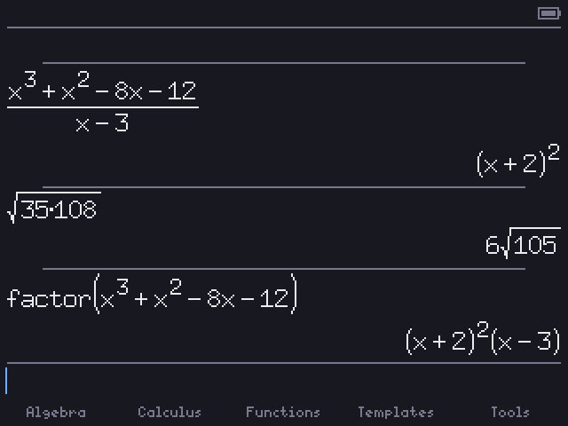
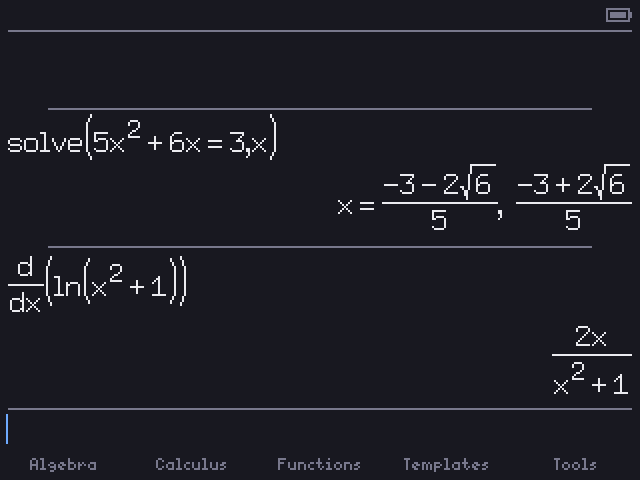

<h1>
  <picture>
    <source media="(prefers-color-scheme: dark)" srcset="media/logo-dark.svg">
    
  </picture>
</h1>

**A CAS for the TI-84 Plus CE** that I'm trying to make simplify better than the TI-Nspire CAS does. You type math the way it looks (stacked fractions, roots, exponents), press enter, and get an exact answer.

<p>
  
  
</p>

**[Try it in your browser](https://cloveian.github.io/fluxion/)** (compiled to WebAssembly)

## What it does
(sorry for the massive block of text, I'm too lazy to make it look nice rn ( • ᴗ - ) ✧)

- enter simplifies, cancels stuff in fractions, pulls square factors out of roots ($\sqrt{35\cdot108} \to 6\sqrt{105}$), keeps everything as exact fractions. By hand, it comes out as one fraction: $\frac{6x}{x+1}-\frac{5}{x+1} \to \frac{6x-5}{x+1}$
- other answer forms one key away: expanded, factored, decimal (`[2nd][enter]` cycles them, `[alpha][enter]` is a decimal just once)
- `factor(` and `expand(`, more than one letter too, $x^2-y^2 \to (x-y)(x+y)$
- `solve(` polynomials (cubics with no nice root too), with letters in it ($\frac{3x-y}{x+y}=\frac{5}{8} \to x = \frac{13y}{19}$), trig equations, complex roots, and inequalities with a sign chart ($x^2-4<0 \to -2<x<2$)
- systems, linear and 2x2 nonlinear ($x^2+y^2=25,\ y=x+1$)
- `d/dx(`, trig / log / hyperbolic identities, complex numbers
- functions: domain, range, holes and asymptotes (slant ones too), inverse, amplitude, piecewise, roots to a polynomial and back
- geometry: a triangle solver, shape formulas (`circle(`, `cone(`, `polygon(` ...), slope / distance / midpoint, parallel and perpendicular lines, ellipses and hyperbolas from the equation or from points
- gcd, lcm, prime factors, nCr / nPr, and probability of independent events
- an actual 2D editor with templates for fractions, roots, exponents and $\lvert x\rvert$, ghost close parens, select / cut / copy / paste, and the cursor moves through all of it
- Nspire-style layout: history on top (arrow up into it to reuse an answer), input on the bottom, the five keys under the screen open folders of commands
- variables you can store and look through, degrees / radians, a few colour themes, and the screen goes off by itself when you leave it

It's still a work in progress: no graphs yet, and integrals only go as far as u-substitution ┐(￣ヘ￣)┌ Everything it does right now is in [docs/features.md](docs/features.md), and the [docs](https://cloveian.github.io/fluxion/docs/) have how I designed it and what's planned.

## Install

You need a TI-84 Plus CE.

1. If you're on OS 5.5 or newer, jailbreak with [arTIfiCE](https://yvantt.github.io/arTIfiCE/) and get a shell like [Cesium](https://github.com/mateoconlechuga/cesium)
2. Send the [CE C libraries](https://github.com/CE-Programming/libraries/releases) (`clibs.8xg`) to the calculator
3. From [releases](https://github.com/Cloveian/fluxion/releases), either
   - **the app** (what I use): send `Fluxion-TI84CE-TIConnectCE.b84` with TI Connect CE, or `Fluxion-TI84CE-TiLP.tig` with TiLP (or unzip `Fluxion-TI84CE-loose-files.zip` and send `FLUXINST.8xp` and the eight `FLUXAPP` files), run `FLUXINST` once, and Fluxion shows up under apps
   - **the program**: send `Fluxion-program.b84` (or `FLUXION.8xp` and its three appvars) and run it from Cesium

### TI-Nspire CX / CX II

1. Install [Ndless](https://ndless.me): r2022 on a CX II with OS 6.4.0.74, or r2021 on a CX with OS 4.5.5 (a CX II on 6.3 has to update to 6.4 first)
2. Send `Fluxion-Nspire.tns` from [releases](https://github.com/Cloveian/fluxion/releases) (or build it yourself with `make nspire`, see Building, it ends up as `bin-nspire/Fluxion.tns`) over with the TI software or TiLP, and open it from My Documents
3. `home` quits it

## Keys

| Key | Does |
|---|---|
| `[enter]` | simplify |
| `[2nd][enter]` | next answer form, `[alpha][enter]` a decimal just once |
| `[y=]` ... `[graph]` | the folders: Algebra, Calculus, Functions, Templates, Tools. A number picks, past 9 it's `[alpha]` + A, B, C like the Nspire, and `→` opens a folder inside a folder |
| `[alpha][x,t,θ,n]` | fraction (`[alpha][y=]` works too, like the TI) |
| `[2nd][math]` | `=` (for `solve(`), `[math]` is `<` `>` `≤` `≥` |
| `[2nd]`, `[alpha]`, `[on]` | work on the next key, or hold them down. Tap twice to lock, once more to unlock. `[2nd][alpha]` + a letter is a capital |
| `↑` | into the history, `[enter]` pastes that answer where the cursor is |
| `[alpha]` + `←` `→` | select, `[on]` + `[1]` `[2]` `[3]` is cut, copy, paste |
| `[on]`+`[mode]` | stop it if it's taking forever |
| `[clear]` | backspace, `[on]`+`[clear]` clears the line (the screen too if the line's empty) |

Variables are lowercase, like on the Nspire.

### On the Nspire

The keys do what they do in its own OS, so most of it you already know:

| Key | Does |
|---|---|
| `enter` | simplify, `ctrl` `enter` a decimal just once |
| `menu` | the folders drop down from the top, a number opens one, `esc` goes back. On the catalog or the steps page it lists that page's keys |
| `ctrl` `x²` `^` `e^x` `10^x` | √, ⁿ√, ln, log |
| `trig` `π▸` `?!▸` | all 12 trig functions, π e i ∞ θ °, and ! % ° |
| `ctrl` `÷`, `ctrl` `=` | fraction, and `=` `≠` `<` `>` `≤` `≥` |
| `shift` + arrows | select, `ctrl` `X` `C` `V` cut, copy, paste, `ctrl` `Z` or `ctrl` `esc` undo |
| `del`, `ctrl` `del` | backspace, clear the line |
| `esc` | close whatever's open, and stop it if it's taking forever |
| `ctrl` `+` `-` | brightness |

The catalog (`cat`) shows the key for anything that has one.

## Building

Needs the [CE C toolchain](https://github.com/CE-Programming/toolchain) (v15):

```sh
make                          # all of the ones below, one after the other
make ce                       # bin-app/Fluxion.8ek, the app
make installer                # bin-installer/, the app + its installer (see installer/README.md)
make bundle                   # bin-bundle/, the installer as one .b84 (TI Connect CE) and one .tig (TiLP)
make release                  # tests, both calculators, the bundles, and all the files to send in release/Fluxion-<version>/
make test                     # PC build + engine tests
./build-pc/fluxion-app        # run it in a window on the PC
make web                      # web/build/, the same thing for a browser (needs emscripten)
make nspire                   # bin-nspire/Fluxion.tns, for Ndless on the TI-Nspire CX / CX II (needs the Ndless SDK, runs on a CX II, keys like its own OS)
```

The PC build needs SDL3. On PC, Shift is `[alpha]`, Alt is `[2nd]`, and Ctrl is `[on]` (when you tap them by themselves).

## LLM use

i did (and still do) the design and the core of it myself, the engine work, editor, layout, platform code n' stuff. agents did the 'busywork', and in the grand scheme of things it's small stuff: a function or a file each, sitting on top of all that, written from a spec i gave it, then merged by me.

- **simple (for a calculator) features**: the triangle solver, amplitude, probability of independent events, ellipses and hyperbolas, piecewise, roots / fromroots and inverse, the shape formulas, 2x2 nonlinear systems, and the editor's ghost brackets, the fraction grabbing the last term and `ans` autofill
- **a few more of those**: complex roots in solve, slant asymptotes, cubics with no rational root, factoring with two letters, domain, gcd / lcm / nCr / nPr, and slope / dist / mid / par / perp
- **ui bits**: brightness and the light theme, the catalog's categories, the padlock icons
- **the grind**: timing every test line, and a couple of speedups that came out of that
- **bug hunting**: crash sweeps and bisecting, which turned up a surprising number of bugs in upstream PineappleCAS (no hate)
- small refactors
- (some of) the website, CSS / layout and the demo problems (no 'content' besides those)

## Credits

- The math engine started as [PineappleCAS](https://github.com/nathanfarlow/PineappleCAS) by Nathan Farlow (MIT), what I changed is in [`src/engine/README.md`](src/engine/README.md)
- [imath](https://github.com/creachadair/imath) by Michael J. Fromberger (MIT) for big numbers
- Fonts from the X11 misc-fixed set (public domain)
- Built with the [CE C toolchain](https://github.com/CE-Programming/toolchain)
- The app installer is [CEaShell-Installer](https://github.com/RoccoLoxPrograms/CEaShell-Installer) by RoccoLox Programs, unmodified
- The keypad on the web page was measured off [CEmu](https://github.com/CE-Programming/CEmu)'s, and the Nspire one off a photo of the real calculator, with its key order and labels from [Firebird](https://github.com/nspire-emus/firebird)'s keypad (no code or images from either)

## License

MIT, see [LICENSE](LICENSE). The engine has its own MIT license in [`src/engine/LICENSE`](src/engine/LICENSE).
